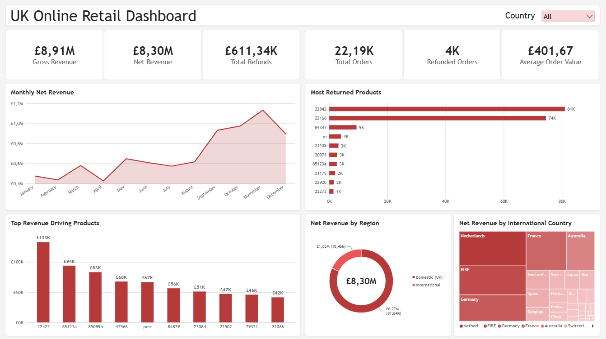
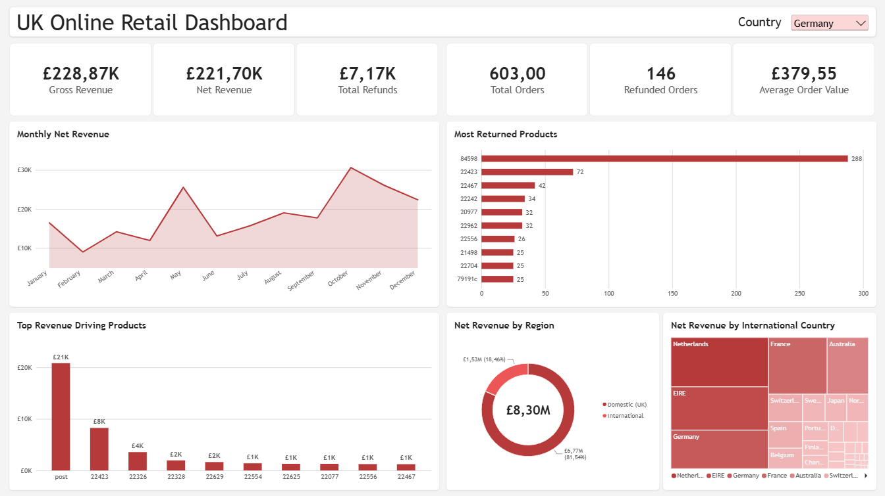
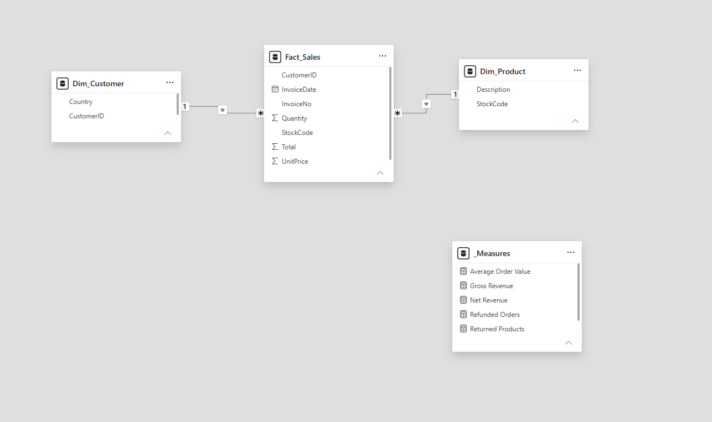

# UK Online Retail Dataset PowerBI Dashboard

An interactive PowerBI dashboard on the UK Online Retail dataset, analyzing over 500K invoices from a UK retailer. The original dataset was cleaned, split into a facts and dimensions schema and used to track financial performance, refund scale and regional distribution of the store orders.

---

Interactive slicing capability was implemented to filter the dashboard by country/region.

---

The original single table data was split into a fact and dimension tables, and the appropriate schema relations were implemented within PowerBI.

---

## Data Source Attribution

The UK Retail data used in this project is sourced from the **Online Retail Dataset** available on the [UCI Machine Learning Repository](https://uci.edu). 

* **Dataset Authors:** Dr. Daqing Chen, School of Engineering, London South Bank University
* **License:** [Creative Commons Attribution 4.0 International (CC BY 4.0)](https://creativecommons.org)
